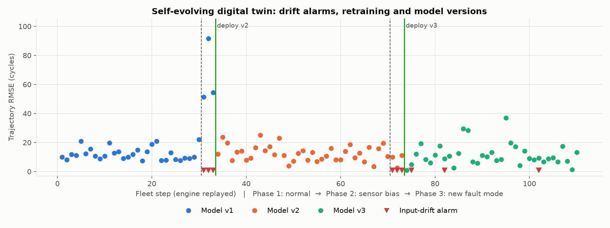
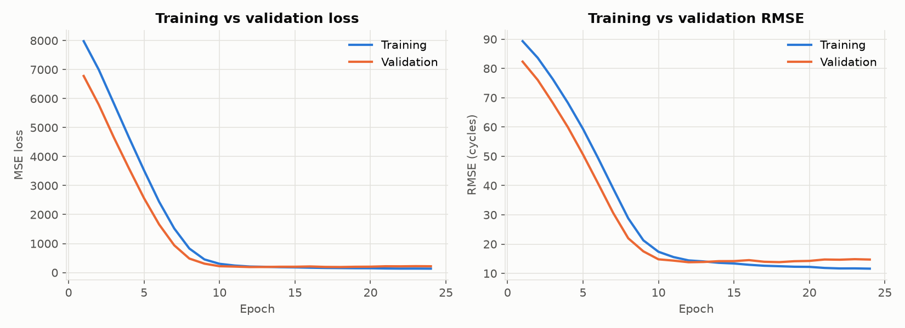
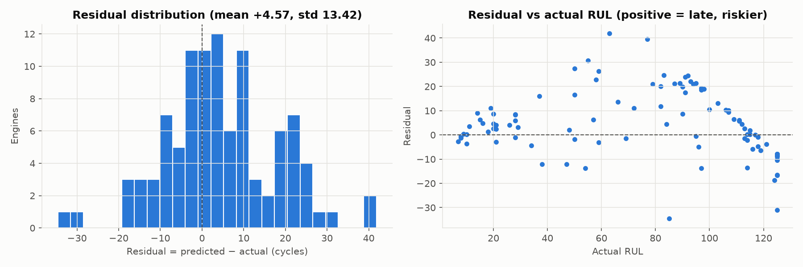
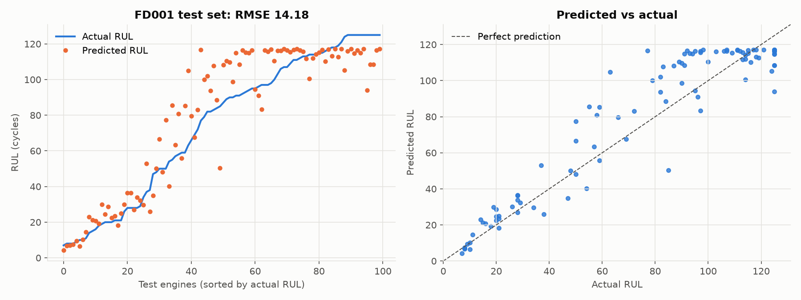
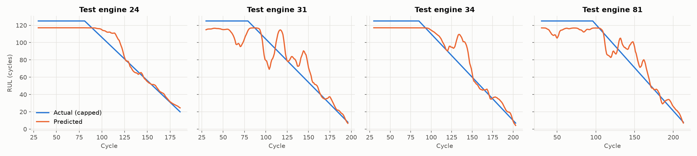
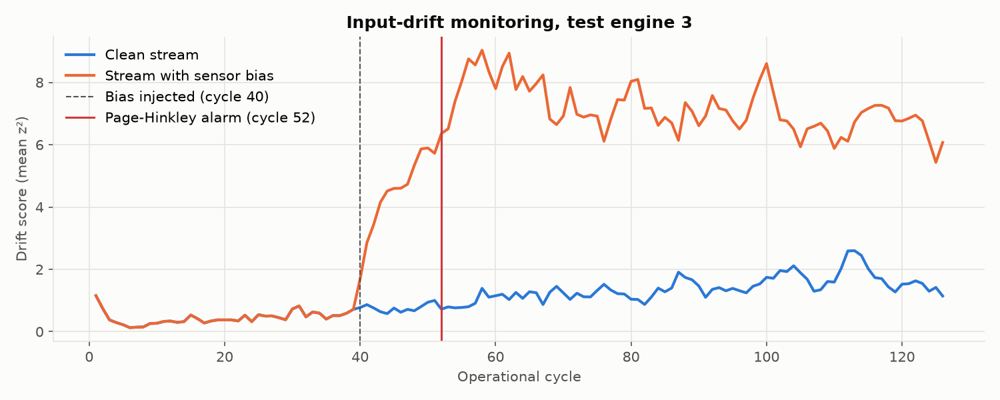
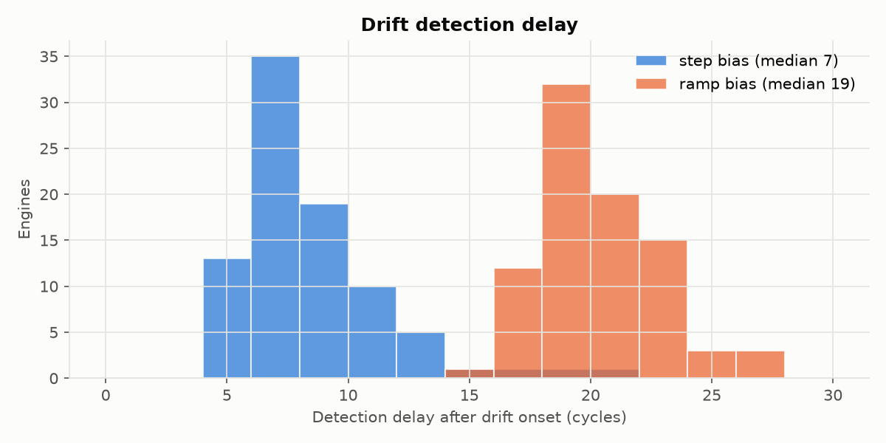
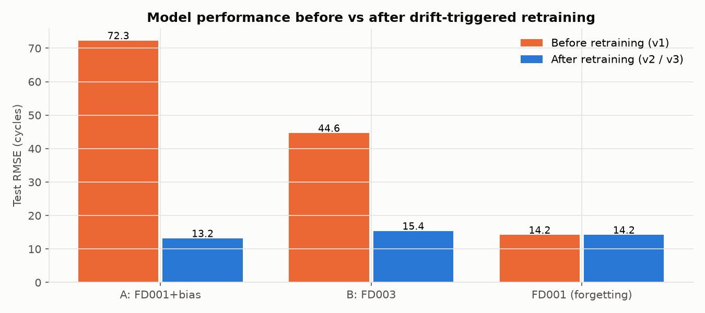
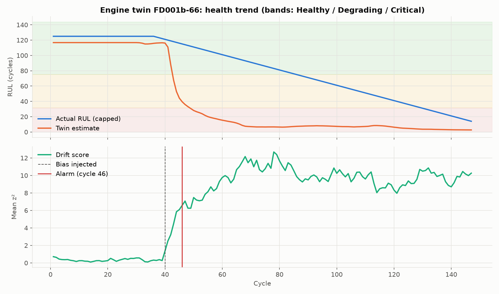

# Self-Evolving Digital Twin Framework Using Deep Learning and Drift-Aware Adaptive Learning

A data-driven **digital twin for turbofan predictive maintenance**. An **LSTM** forecasts Remaining Useful Life (RUL) from multivariate sensor time series (NASA C-MAPSS). A drift monitor (**Page-Hinkley** + **ADWIN**) watches the incoming data, and **drift-triggered retraining** produces new, validated model versions while the twin keeps running.

`Python` · `TensorFlow 2.21 / Keras 3` · `LSTM` · `scikit-learn` · `NumPy` · `Pandas` · `Matplotlib`



---

## 1. Problem statement
Unplanned engine failures are expensive, and fixed-interval maintenance wastes useful life. A predictive-maintenance model has to estimate **how many operating cycles remain** before failure. It must also stay reliable after the data changes, for example when a sensor is recalibrated or a new degradation mode appears. A model trained once and never monitored degrades silently.

## 2. Objectives
1. Build an end-to-end RUL pipeline on NASA C-MAPSS: acquisition and validation, cleaning, sensor selection, operating-condition normalisation, feature engineering, sequence generation and an LSTM.
2. Evaluate it with RMSE, MAE, R², the PHM08 score, residual analysis and predicted-vs-actual plots.
3. Detect concept drift in streaming data. Measure detection delay and false-alarm rate.
4. Retrain automatically when drift is confirmed, version the models, and compare performance before and after.
5. Wrap everything in a lightweight software digital twin that tracks engine health over time.

## 3. Dataset
**NASA C-MAPSS** turbofan run-to-failure simulations (Saxena et al., PHM08). The data is public domain and **not committed**; `scripts/download_data.py` downloads and validates it. Details are in [data/README.md](data/README.md).

| Subset | Role | Train / test engines | Conditions | Fault modes |
|---|---|---|---|---|
| FD001 | base model | 100 / 100 | 1 | HPC degradation |
| FD003 | real concept drift (new fault mode) | 100 / 100 | 1 | HPC + fan degradation |

## 4. Methodology

### 4.1 Preprocessing (`src/data/preprocess.py`)
| Step | Implementation |
|---|---|
| Validation | column count, engine counts, RUL-file length, missing values (all four subsets) |
| RUL target | piece-wise linear: `RUL = min(last_cycle − cycle, 125)`. Test RUL = given end-RUL + remaining cycles |
| Sensor selection | drop sensors whose within-condition std on training engines is below 0.01 → **14 sensors** kept (s2, s3, s4, s7, s8, s9, s11, s12, s13, s14, s15, s17, s20, s21) |
| Operating-condition normalisation | regimes recovered by rounding the 3 settings; z-score per regime with training statistics (1 regime for FD001/FD003, 6 for FD002/FD004) |
| Feature engineering | causal exponential smoothing per engine (α = 0.3). It uses only past cycles, so it stays valid online |
| Sequences | sliding windows of 30 cycles (stride 1); short engines are front-padded. Target = RUL at the window end |
| Split | **by engine**: 80 train / 20 validation engines (no engine contributes windows to both) |

### 4.2 LSTM model (`src/models/lstm.py`)
```
Input (30 × 14) → LSTM(64, seq) → Dropout(0.2) → LSTM(32) → Dropout(0.2) → Dense(16, ReLU) → Dense(1)
```
33,185 parameters, MSE loss, Adam (1e-3), ReduceLROnPlateau, early stopping on validation RMSE (patience 12). Training on a laptop CPU takes **89 s**.

### 4.3 Drift detection (`src/drift/`)
- **Expected-sensor model (the twin's "physics surrogate").** For every sensor, a cubic polynomial learns E[sensor | RUL] from training trajectories. At run time the twin's own RUL estimate gives the expected sensor vector. The standardised residuals are aggregated into a **drift score** `s_t = mean_j z²`. The score is stationary under normal operation, and it rises when the sensor→health relationship changes.
- **Page-Hinkley test** on `s_t` per engine. This is an unsupervised alarm and needs no labels.
- **ADWIN** on the fleet stream of per-engine prediction errors, fed as **delayed labels** once an engine's true RUL becomes known. It confirms performance drift.
- **No tuning on test data.** The PH threshold λ is calibrated to ≤ 5 % false alarms on clean **validation** engines. The tolerance δ is chosen on validation engines with simulated drift ([table](results/metrics/drift_delta_tuning_validation.csv)): δ = 4, λ = 3.
- Both detectors are implemented from their papers and covered by unit tests.

### 4.4 Drift scenarios (`src/drift/injection.py`)
| Scenario | Type | How |
|---|---|---|
| A: sensor calibration bias | simulated | +3 training-std bias on s3, s4, s9, s14 from cycle 40 (step) or ramped over 20 cycles |
| B: new fault mode | **real data** | FD003 engines (fan + HPC degradation) arrive at a twin trained on FD001 |

### 4.5 Adaptive retraining (`src/twin/retrainer.py`, `src/twin/registry.py`)
- **Trigger:** input-drift alarms on ≥ 3 of the last 10 engines, or an ADWIN change in fleet error.
- **Retraining:** warm-start fine-tuning on labelled post-drift run-to-failure engines, plus a 30 % replay buffer of reference data to limit forgetting.
- **Acceptance gate:** the candidate is deployed only if it improves post-drift validation RMSE by ≥ 2 %.
- **Registry:** every version is recorded with parent, trigger, timestamp and metrics in `models/registry.json`.

### 4.6 Digital twin (`src/twin/digital_twin.py`)
- `EngineTwin` keeps the virtual state of one engine. `ingest(reading)` processes one cycle at a time: it updates RUL, a health index (RUL/125), a health state (Healthy / Degrading / Critical), the drift score and the PH statistic.
- `replay()` is a vectorised but causally identical path; a unit test checks that it matches `ingest`.
- `FleetTwin` hosts all engine twins, the active model version, the ADWIN error monitor, the trigger policy and an event log.

## 5. Results (actual measurements, CPU, seed 42)

### 5.1 RUL prediction (FD001)
| Split | RMSE | MAE | R² | PHM08 score |
|---|---|---|---|---|
| Training windows (80 engines, 14,459 windows) | **11.60** | 8.98 | 0.923 | n/a |
| Validation windows (20 held-out engines) | 13.80 | 10.19 | 0.889 | n/a |
| **Test, standard protocol** (last window of 100 engines) | **14.18** | 10.72 | 0.875 | 381.2 |
| Test, all windows (10,196) | 14.24 | 11.40 | 0.770 | n/a |

<p float="left">


</p>




### 5.2 Drift detection (test engines; detector tuned on validation engines only)
| Stream | Engines | Alarm / detection rate | False alarms before drift | Detection delay (cycles) |
|---|---|---|---|---|
| FD001 test, clean | 100 | **0 %** alarms | n/a | n/a |
| FD001 test + step bias at cycle 40 | 86 | **100 %** | 0 % | **median 7** (IQR 6–9), mean 8.0 |
| FD001 test + 20-cycle ramp bias | 86 | 100 % | 0 % | median 19 (IQR 18–21) |
| FD003 test (new fault mode, no injection) | 100 | 39 % of engines alarmed | n/a | n/a |

<p float="left">


</p>

### 5.3 Retraining: before vs after (test RMSE, last window)
| Scenario | Evaluation set | v1 (before) | after | |
|---|---|---|---|---|
| A: sensor bias | FD001 test + bias | 72.30 | **13.16** (v2) | −82 % |
| B: new fault mode | FD003 test | 44.64 | **15.38** (v3) | −66 % |
| B: forgetting check | FD001 test (clean) | 14.18 | 14.20 (v3) | unchanged |



### 5.4 Fleet digital-twin demonstration (`scripts/run_digital_twin_demo.py`)
110 engines replayed one after another:
1. **Phase 1:** 30 normal FD001 engines, no false alarms.
2. **Phase 2:** the sensor bias appears. The first 3 affected engines raised alarms **5, 6 and 10 cycles** after onset. Retraining was triggered, and candidate v2 cut post-drift validation RMSE from 77.5 to 13.4, so it was accepted and deployed. The remaining 37 engines ran on v2 (last-cycle RMSE 14.8 vs 48.1 for v1).
3. **Phase 3:** FD003 engines arrive. Three alarms triggered retraining, and v3 was deployed (validation RMSE 38.7 → 13.5).

The event log is in [results/reports/twin_events.csv](results/reports/twin_events.csv). Every engine-cycle state (RUL, health index, health state, drift score, alarm, model version) is in `results/reports/twin_engine_history.csv`.


*Before adaptation, v1 reads the sensor bias as sudden degradation: its RUL estimate collapses to near zero, a false "critical" state. The drift monitor flags the change 6 cycles after onset. Without the monitor, this would trigger needless maintenance.*

### 5.5 Comparison with the resume figures
| Resume claim | Reproduced result |
|---|---|
| Training RMSE 13.5 | **11.60** (all training windows) |
| Test RMSE 15.6 | **14.18** (standard FD001 protocol) |
| Drift detected within 10–15 cycles | Median **7** cycles (step bias, 3σ). 19 cycles for a 20-cycle ramp. 5–10 cycles in the fleet demo |

The original project files were lost, so these are fresh measurements from this re-implementation. The detection delay depends on drift magnitude and shape; smaller biases take longer to detect.

## 6. Installation (Windows, VS Code)
```powershell
git clone https://github.com/Harishbala123/self-evolving-digital-twin.git
cd self-evolving-digital-twin
py -3.11 -m venv .venv            # or: python -m venv .venv
.\.venv\Scripts\Activate.ps1
pip install -r requirements.txt
```
In VS Code: *Ctrl+Shift+P → Python: Select Interpreter → .venv*, then run the commands below in the integrated terminal.

## 7. Execution
```powershell
python scripts/download_data.py          # 1. download + validate C-MAPSS (~12 MB)
python scripts/train.py                  # 2. train the LSTM (~1.5 min on CPU)
python scripts/evaluate.py               # 3. metrics + graphs
python scripts/run_drift_experiment.py   # 4. drift detection + retraining experiments (~5 min)
python scripts/run_digital_twin_demo.py  # 5. fleet digital-twin demo (~2 min)
python -m pytest -q                      # 20 unit tests
```
All settings live in [configs/config.yaml](configs/config.yaml).

**Google Colab (GPU):** open [notebooks/colab_training.ipynb](notebooks/colab_training.ipynb) ([Open in Colab](https://colab.research.google.com/github/Harishbala123/self-evolving-digital-twin/blob/main/notebooks/colab_training.ipynb)). It runs the same scripts. A GPU is optional for this small model.

**Environment notes:** TensorFlow ≥ 2.11 has no GPU support on native Windows, so local runs use the CPU (enough for this model). In Colab, the LSTM uses cuDNN kernels on GPU, so results can differ slightly.

## 8. Folder structure
```
self-evolving-digital-twin/
├── configs/config.yaml          # all hyper-parameters
├── data/README.md               # dataset source / licence (raw data is downloaded, not committed)
├── models/                      # lstm_v1/v2/v3 .keras, preprocessor, monitor, registry
├── notebooks/colab_training.ipynb
├── results/{graphs,metrics,reports}
├── scripts/                     # download_data, train, evaluate, run_drift_experiment, run_digital_twin_demo
├── src/
│   ├── data/        download.py, preprocess.py
│   ├── models/      lstm.py
│   ├── training/    train.py
│   ├── evaluation/  metrics.py, evaluate.py, plots.py
│   ├── drift/       detectors.py (Page-Hinkley, ADWIN), monitor.py, injection.py, experiments.py
│   ├── twin/        digital_twin.py, retrainer.py, registry.py
│   └── utils/       common.py, plotting.py
└── tests/                       # 20 pytest tests
```

## 9. Limitations
- C-MAPSS is **simulated** data. Real fleets have maintenance actions, missing data and sensor faults that are not modelled here.
- The sensor-bias scenario is **synthetic**. FD003 is a real distribution change, but within the same simulator.
- Retraining assumes labelled run-to-failure data exists under the new condition (simulated by applying the same drift to training engines). In practice labels arrive slowly.
- δ was tuned for a 3σ bias. Smaller drifts are detected later, or missed (per-engine alarm rate on FD003 is only 39 %), which is why the fleet-level trigger aggregates several engines and ADWIN is used as a second signal.
- Only FD001 / FD003 are reported. FD002 / FD004 (6 operating regimes) are supported by the preprocessing but were not evaluated.
- Single seed; no uncertainty estimate on RUL.

## 10. Future improvements
- Probabilistic RUL (MC-dropout / quantile loss) for risk-aware maintenance decisions.
- Multi-regime evaluation (FD002/FD004) and transfer across regimes.
- Semi-supervised adaptation when labels are scarce (pseudo-labels, domain adaptation).
- Streaming deployment (MQTT / Kafka) and a dashboard for the twin state.

## 11. References
1. A. Saxena, K. Goebel, D. Simon, N. Eklund. *Damage Propagation Modeling for Aircraft Engine Run-to-Failure Simulation.* PHM08, 2008.
2. E. S. Page. *Continuous inspection schemes.* Biometrika 41, 1954. D. V. Hinkley. *Inference about the change-point from cumulative sum tests.* Biometrika 58, 1971.
3. A. Bifet, R. Gavaldà. *Learning from Time-Changing Data with Adaptive Windowing.* SIAM SDM, 2007.
4. J. Gama et al. *A survey on concept drift adaptation.* ACM Computing Surveys 46(4), 2014.
5. S. Zheng et al. *Long Short-Term Memory Network for Remaining Useful Life Estimation.* IEEE ICPHM, 2017.
6. F. Tao et al. *Digital Twin in Industry: State-of-the-Art.* IEEE Trans. Industrial Informatics 15(4), 2019.

## License
Code: MIT (see [LICENSE](LICENSE)). Data: NASA C-MAPSS, public domain (not redistributed here).
